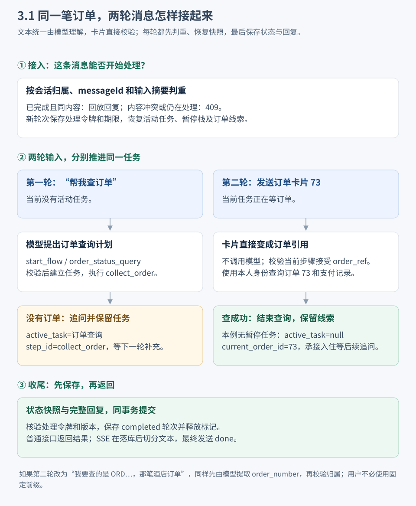
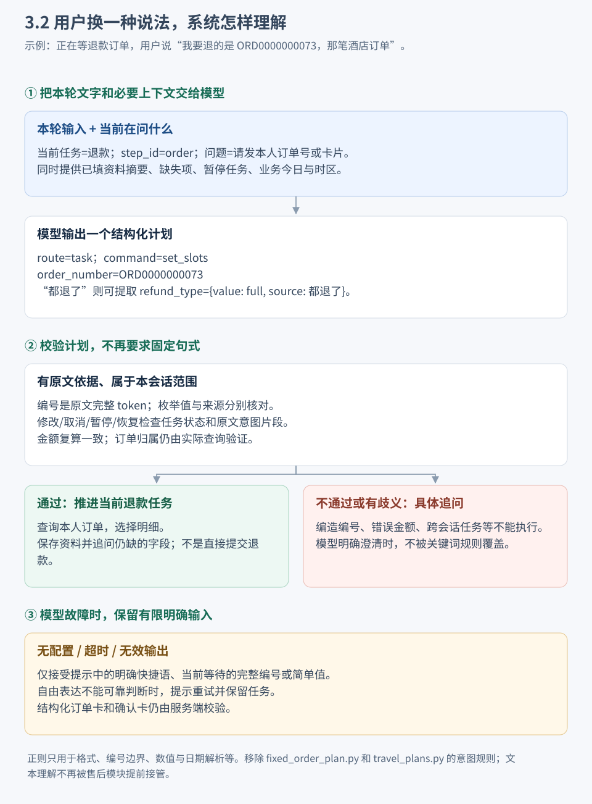
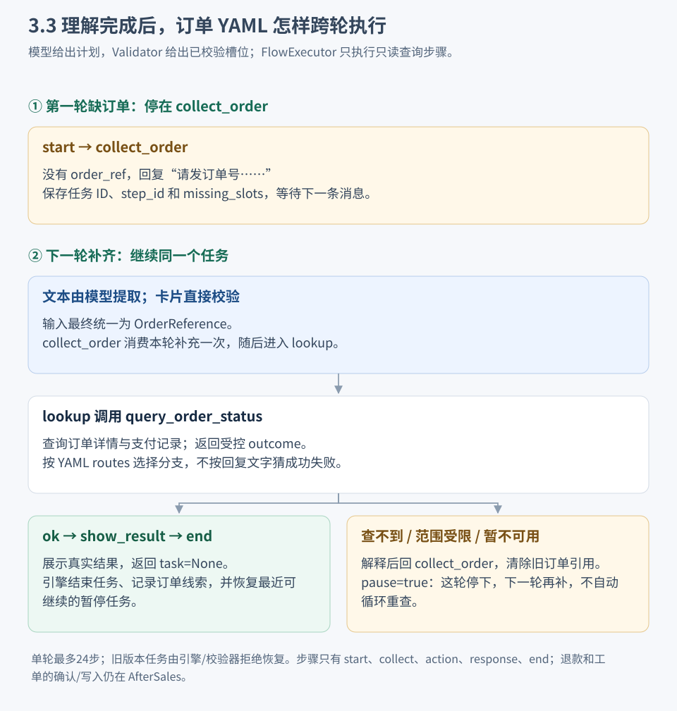
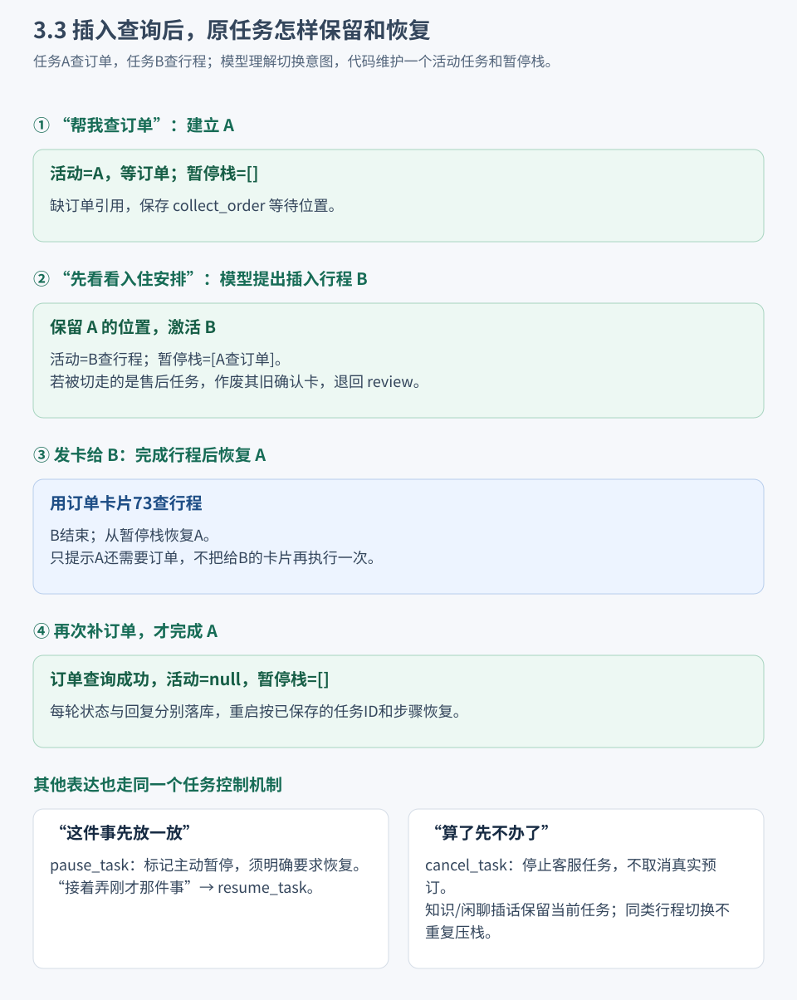
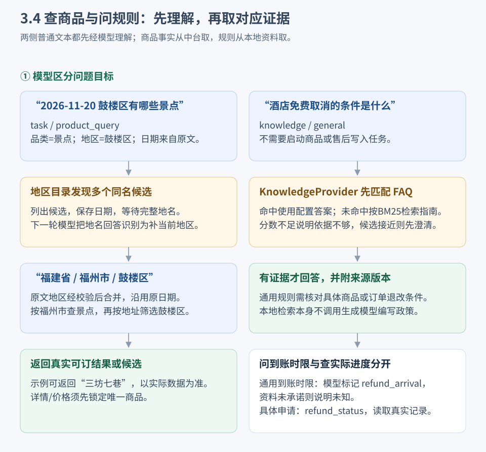
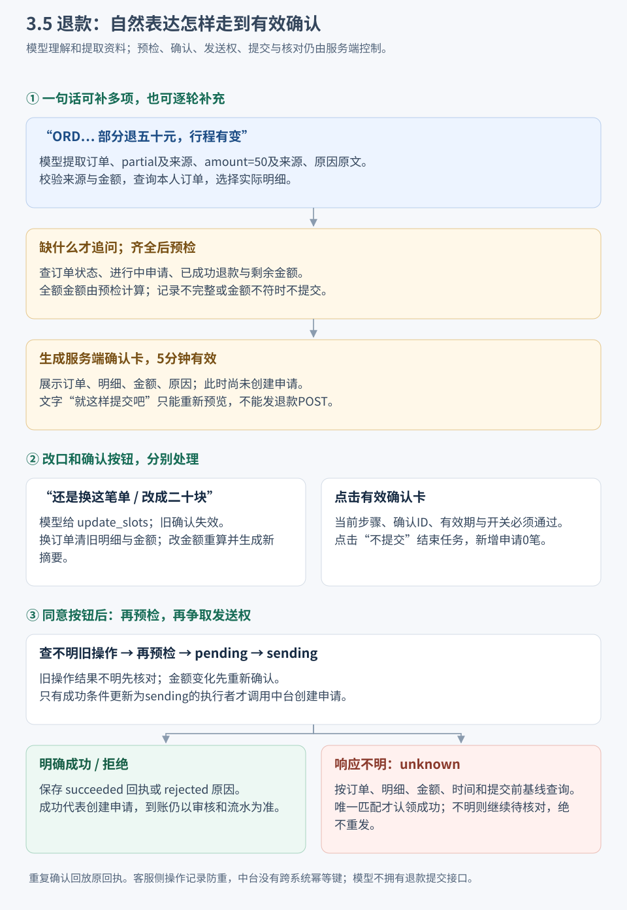
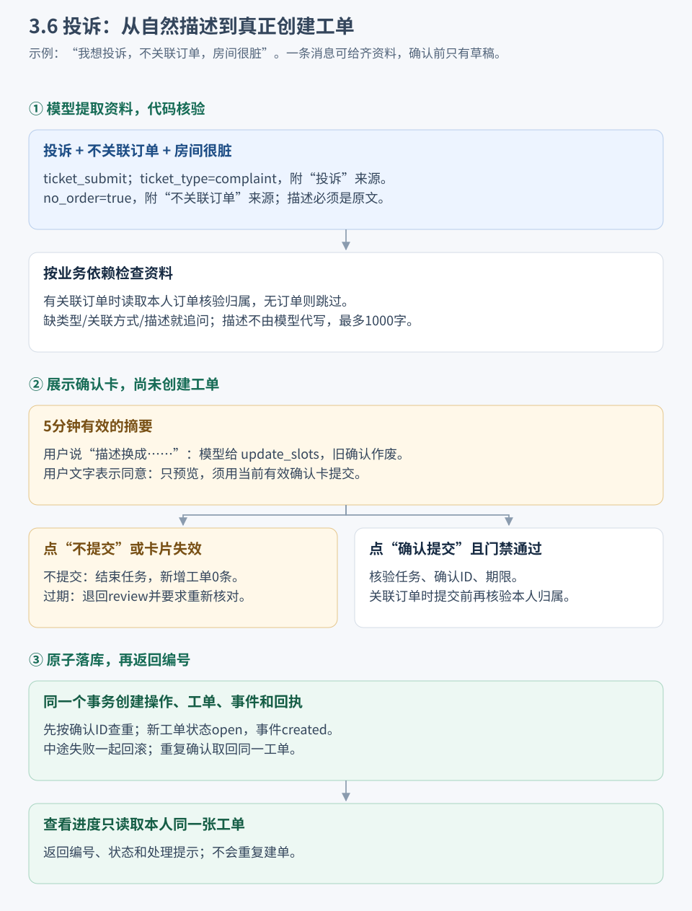
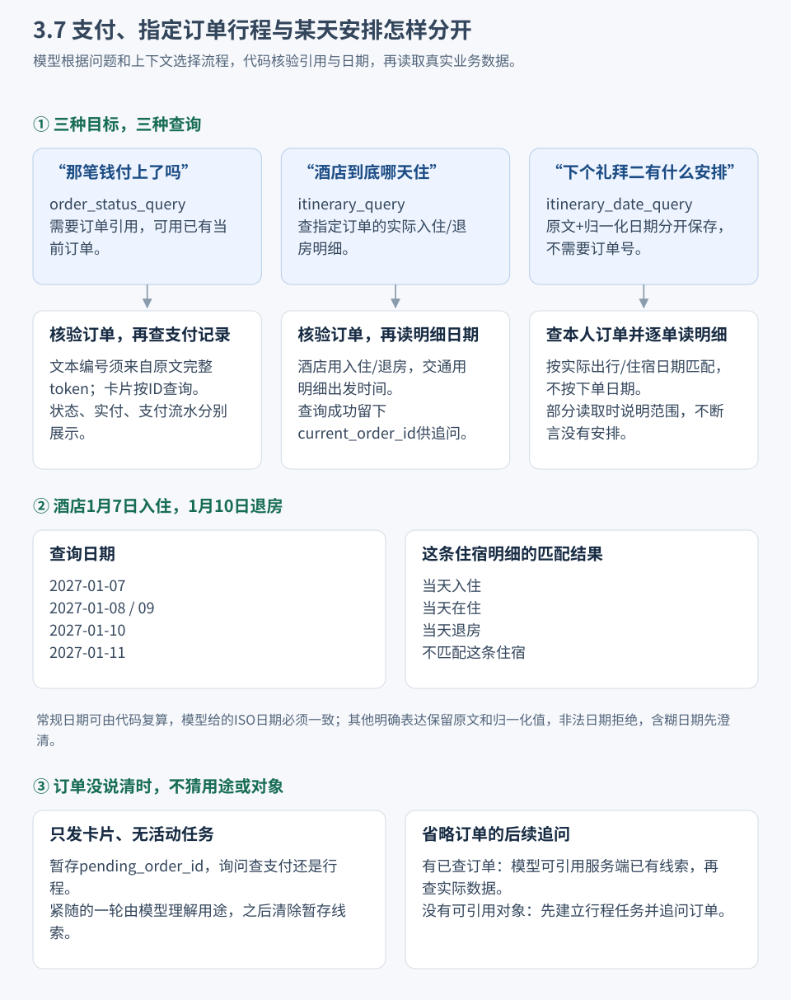

# 旅游智能客服系统技术设计

## 1. 项目边界与技术选型

新建独立项目 `travel-custom-service`。客服服务负责理解用户请求、管理多轮任务、检索知识、调用旅游中台、创建客服工单，并提供对话与会话接口。业务前台通过接口联调，客服项目提供一页调试界面，用于发送文本、选择业务卡片、查看当前任务及验证 SSE。

| 系统                           | 职责                          | 集成方式                                         |
| ---------------------------- | --------------------------- | -------------------------------------------- |
| 旅游中台 `travel-data`           | 商品、价格、库存、用户、订单、支付、退款申请和退款记录 | 通过已提供的 HTTP API 查询和提交                        |
| 智能客服 `travel-custom-service` | 对话编排、上下文、知识检索、客服工单、会话历史和状态  | 独立 FastAPI 服务，独立 `travel-custom-service` 数据库 |
| 前台或调试页                       | 展示消息、候选订单和产品、确认卡片、工单结果      | JSON 接口和 SSE                                 |

首版使用 Python 3.12、uv、FastAPI、Pydantic、HTTPX、PyYAML、SQLAlchemy 和 MySQL 8。只读查询流程用 YAML 定义，由 `FlowExecutor` 执行限定步骤；退款和工单由 `AfterSales` 校验结构化资料并处理确认，`after_sales.yaml` 只提供提示文案。`TurnPlanner` 对所有普通文本优先调用模型理解意图、补充、修改和任务切换；`TurnPlanValidator` 校验结构、原文依据、字段范围与业务状态。订单卡片和确认按钮是结构化输入，直接走服务端校验。模型缺失、不可用或输出无效时，只保留有限明确输入的降级，不用关键词猜测自由表达。Action 在应用启动时装配成字典交给执行器，没有单独的 `ActionRegistry` 类。知识检索由独立 Provider 承担。

按 `omni_support` 的对话主干组织新项目。借鉴任务实例、计划校验、流程推进和 Action 接口。旅游项目重新定义对象 ID、业务 Action、知识来源和按会话恢复的行为。旧项目的退款步骤只渲染文案，FAQ/RAG Provider 返回占位结果，旅游版分别接入真实中台提交与真实知识资料。需求原件也明确要求创建真实工单和配置化新增任务。 [旅游需求说明](../1.资料/旅游/需求说明.md)· [参考项目](D:/code_workspace/omni_support)

文档里的客服接口、字段和验收样例是新项目的设计约定。示例订单、会话和工单 ID 用于说明契约，联调时从已经生成的旅游数据中选取实际样本。

## 2. 目录与模块

```text
travel-custom-service/
  app/                 # FastAPI 路由、请求与响应模型、身份依赖
  service/             # 会话创建、对话执行、幂等与 SSE
  engine/              # DialogueEngine，调度本轮处理
  plan/                # TurnPlanner、TurnPlan、TurnPlanValidator
  task/
    flow/              # FlowLoader、FlowExecutor、步骤模型
    action/            # 订单、行程、日期行程和商品查询 Action
    after_sales.py     # 退款和工单的收集、确认与回执
    refunds.py         # 退款预检、提交和结果核对
  integration/         # TravelClient、地区映射、中台 DTO
  knowledge/           # FAQ、文档检索、证据组织
  repository/          # 会话、轮次、写操作和工单仓储
  flow_config/         # YAML 流程、槽位与售后提示文案
  resources/           # FAQ、知识文档、地区映射、示例数据配置
  migrations/          # 客服数据表迁移
  fronted/             # 单页联调界面，由根路径 / 提供
  tests/               # 流程、接口契约与联调测试
```

配置至少包含 `TRAVEL_API_BASE_URL`、`SUPPORT_DATABASE_URL`、`BUSINESS_TIMEZONE`、模型连接参数和外部调用超时。中台地址跟随实际启动端口。首版把中台无时区时间按双方约定的业务时区解析，中文相对日期也使用该时区，示例使用 `Asia/Shanghai`。客服 HTTP 时间字段统一返回 UTC 时区的 ISO 8601 字符串。

## 3. 对话主链路与关键节点

### 3.1 一条消息的整体流程

以“先说查订单，再发送订单卡片”为例。沿两轮输入看：本轮做了什么、停在哪里、保存了什么，以及下一轮怎样接上。蓝色表示用户输入，绿色表示保存的状态或确定结果，黄色表示等待或提交前检查，红色表示拒绝或异常。图中业务数据用于说明流程，以实际查询为准。



#### 3.1.1 消息接入、处理与落库｜O01

**场景** 多轮查订单和支付，刷新后查看历史。
**数据** 用户 `73`，订单号 `ORD0000000073`，订单 ID `73`。
**操作** 发送「帮我查订单」-> 等客服追问订单号 -> 找到右侧 `ORD0000000073` 的卡片，点「发送订单」-> 收到结果后刷新页面，打开原会话。
**预期** 第一轮追问订单号 -> 第二轮返回订单 `ORD0000000073`、已支付、实付 `2733.00 CNY`、一笔成功支付及支付时间 `2026-11-10 20:57:42` -> 刷新后，两轮消息和回复都在历史里。

### 3.2 TurnPlanner、计划校验与槽位来源

所有普通文本，包括退款、工单的补资料和改口，都先由模型生成候选 `TurnPlan`。模型得到当前问题、活动任务、已收集条件、缺失字段、暂停任务以及业务日期/时区；再由校验器核对能否执行。订单卡片和确认按钮直接校验，不调用模型。以一句话查询航班说明：模型提取日期、地点与班次，代码核对原文与格式，再实际查询舱位。



#### 3.2.1 规划、校验与槽位提取｜P05

**场景** 一句话给齐航班查询条件，由模型生成结构化计划，再校验并查询。
**数据** 用户 `73`，`2026-11-20`，北京到上海，航班 `CA1501`。
**操作** 发送「2026-11-20 北京到上海 CA1501 航班舱位」-> 等待航班详情。
**预期** 直接提取日期、出发地、到达地和航班号 -> 校验通过后查询 `CA1501` -> 返回 `13:00` 出发、`15:10` 到达，经济舱 `2281.00` 元、余 `9` 张，商务舱标为不可售。


#### 3.2.2 计划字段、语义理解与执行边界

正常链路为「用户文本 → 模型理解 → 计划校验 → 更新任务 / 查询 / 等待确认 → 保存结果」。一次请求只执行一个明确任务，但同一个任务可以一次补齐多个条件。模型明确返回澄清时，不再用本地关键词覆盖它。

| 字段 | 含义与约束 |
| --- | --- |
| `route` | `task`、`knowledge`、`chitchat`、`clarify`。非任务路由不能夹带任务命令或业务条件。 |
| `command` | `start_flow`、`set_slots`、`update_slots`、`resume_task`、`pause_task`、`cancel_task`、`preview`、`refund_status`。 |
| `flow_id` / `task_id` | 只允许已装配的流程与本会话任务；补充和修改只针对活动任务。 |
| `order_number` / `use_current_order` | 编号须是本轮原文中的完整 token；引用当前订单只能使用服务端已有线索，查询时仍核验归属。 |
| `sales` | 退款与工单条件：明细、退款类型、金额、工单类型、无订单、原因、描述。 |
| `clear_field` / `intent_text` | 修改可先清除一个字段并重新追问；修改、恢复、暂停、取消、预览须附本轮意图片段，不再检查固定动词。 |
| `product` | 商品品类、地区、出发/到达、日期、关键词、星级/类型及详情需求。酒店与景点地区用 `area`。 |
| `date_text` / `date_value` | 原始表达与归一化 ISO 日期分开；以业务今日和时区换算。可解析日期须一致，非法日期拒绝；含糊时间由模型澄清。 |
| `refund_lookup` | 最近申请，或按订单号、申请 ID、申请编号之一查询；按订单可再指定明细。编号仍校验原文。 |
| `knowledge_topic` / `clarify_reason` | 问答类型与澄清原因；实际政策来自 FAQ/文档，不能由模型自行补事实。 |

例如，系统在等退款类型，用户说「都退了」，模型可输出：

```json
{"route":"task","command":"set_slots","sales":{"refund_type":{"value":"full","source":"都退了"}}}
```

枚举允许规范化，`source` 保留原始表达；代码检查原文存在、值属于允许枚举，再推进流程。订单号、原因和描述直接保存原文片段，不由模型编写。金额还须从唯一明确数值复算，与模型规范化值相同；多个金额、比例或无法核对的表达先澄清。酒店星级、类型也分别附原文片段，不能把筛选词塞进酒店名称。

模型不拥有业务写入权限。文本「就这样提交吧」只能生成 `preview`，重新展示确认卡；真正创建退款申请或工单仍由有效确认卡按钮触发，并检查归属、有效期、预检、开关与幂等记录。`cancel_task` 只停止客服任务；取消已订业务须进入退款办理，不能直接取消中台订单。

#### 3.2.3 正则保留范围、降级与上下文

移除 `fixed_order_plan.py`、`travel_plans.py` 的主流程语义规则，以及引擎、售后、知识问答中的关键词分流。编号/数值格式、原文 token 边界、日期解析、行政区清洗和文档分段继续使用确定性代码或正则，它们不决定用户业务意图。`input_values.py` 负责值与来源检查，`fallback.py` 只在模型故障时接收界面提示的有限快捷语、当前等待的完整订单号或简单值。

模型无配置、连接失败、超时或结构无效时，不根据自由表达猜测操作；无法降级的输入返回具体提示并保留原任务。单个 JSON 对象是模型输出契约；单元素对象数组只解开包装后重新校验，多个有效计划直接澄清为多请求，不选取其中一条执行。函数调用包装、未知字段、空数组等结构错误最多请求模型修正一次；两次请求共用最多 12 秒的理解时限，仍无效才降级。模型采样温度为 0，降低结构输出波动。

本轮文字会发送给已配置的模型，因此本轮填写的原因、投诉描述也属于模型输入。历史原因/描述只发送是否已填，不重发正文；不发送完整历史、用户 ID、订单明细、确认 ID 或提交目标。商品已收集条件与当前查询所需槽位作为必要摘要发送。来源校验只能证明内容来自输入，不能证明模型的语义判断必然正确，最终摘要仍须用户核对。

模型超时最多 12 秒，售后处理上限 16 秒，给 30 秒轮次处理期限预留落库余量；查询与退款进度另有各自时限。到期接管和防旧状态覆盖仍按第 4.3 节处理。

### 3.3 FlowExecutor 与多轮切换

**订单 YAML 怎样跨两轮执行**

图中使用实际步骤 ID：第一轮在 `collect_order` 等待，第二轮补上订单引用后进入 `lookup`。重点看成功后怎样结束，以及失败后怎样清除旧引用、回到原位置等待重试。



**插入行程查询后，原订单任务怎样恢复**

A、B 是图中的任务别名。按四条用户输入查看活动任务和暂停栈的变化，尤其注意：完成 B 后恢复 A，只提示 A 的下一步，不会把给 B 的订单卡片再自动执行一次。



#### 3.3.1 FlowExecutor 与多轮切换｜D01

**场景** 查订单时插入行程查询，重启后完成行程，再恢复原订单任务。
**数据** 用户 `73`，订单卡片 `73`，订单号 `ORD0000000073`。查状态用 [Swagger](http://127.0.0.1:18082/docs) 的 `GET /api/v1/support/sessions/{session_id}/state`，请求头填 `X-User-Id: 73`。会话 ID 可从浏览器网络面板的消息请求路径复制。
**操作** 发送「帮我查订单」-> 查状态，记下 `activeTask.taskId` -> 发送「帮我查行程」-> 查状态，记下行程任务 ID -> 重启客服服务，重新打开原会话 -> 查状态后点右侧「发送订单」-> 等行程回复和恢复提示出现 -> 再点一次「发送订单」。
**预期** 第一轮订单任务等待补槽 -> 第二轮行程任务变为活动任务，订单任务进入 `pausedTasks` -> 重启后两个任务 ID 与原来一致 -> 第一次发卡返回白天鹅宾馆套房的入住和退房日期，并恢复原订单任务、再次追问订单号 -> 第二次发卡才返回支付结果，此时 `activeTask` 为 `null`，`pausedTasks` 为 `[]`，历史共四轮。

### 3.4 产品查询与知识证据

左侧用“同名鼓楼区查景点”展示模型识别补充地区、跨轮保留日期和实际查商品；右侧由模型识别规则问答，再用“酒店免费取消”展示 FAQ、章节检索和来源。两条链路分别读取实时商品数据与本地知识资料。



#### 3.4.1 商品查询｜P09

**场景** 地区同名时追问具体地区，选定后沿用原查询日期。
**数据** 用户 `73`，查询日 `2026-11-20`，目标地区「福建省 / 福州市 / 鼓楼区」。
**操作** 发送「2026-11-20 鼓楼区有哪些景点」-> 等客服列出候选 -> 回复「福建省 / 福州市 / 鼓楼区」。
**预期** 第一轮列出多个鼓楼区并等待选择 -> 第二轮沿用 `2026-11-20` 查福州市鼓楼区 -> 返回「三坊七巷」。

#### 3.4.2 知识证据｜K02

**场景** 在知识文档里检索酒店免费取消规则。
**数据** 用户 `73`，问题「退改规则里，酒店免费取消的条件是什么」。
**操作** 发送这条问题 -> 查看回复正文和来源。
**预期** 命中「产品退改规则」章节 -> 回复需要核对具体商品或订单明细的退改条件 -> 附来源「《旅游平台使用指南》·产品退改规则（v1.0）」。

### 3.5 退款申请

文本先由模型识别退款意图和具体字段，再由服务端依业务依赖收集缺项；一句话可以给齐多项资料，改口使用 `update_slots`。沿“订单 → 全额 → 原因 → 确认卡”看清提交边界：收集资料和看到确认卡时都尚未创建退款申请；只有点击有效确认卡且写入开关开启后才进入提交链，文字表达提交只重新预览。下图同时展示取消、明确回执和结果不明三类去向。



#### 3.5.1 退款申请｜R01

**场景** 核对全额退款预检和确认卡，最后取消提交。
**数据** 用户 `199`，订单号 `ORD0000000199`，唯一明细 ID `199`，剩余可申请退款金额 `3469.20` 元，原因「行程有变」。
**操作** 发送「申请退款」-> 被问订单时回复「ORD0000000199」-> 被问退款类型时回复「全额」-> 被问退款原因时回复「行程有变」-> 核对确认卡 -> 点「不提交」。
**预期** 系统自动选中明细 `199` -> 确认卡显示订单号、明细、金额 `3469.20` 和原因 -> 点「不提交」后提示已取消，退款任务结束，新增退款申请 `0` 笔。

### 3.6 投诉与工单

模型理解投诉意图、类型、关联订单或无订单以及描述，校验后交给售后模块存草稿；同一消息可填多项，描述不得由模型编造。用“房间与预订描述不一致”说明：看到确认卡时尚无工单，点击有效确认卡后在一个事务里创建工单、创建事件和回执；重复确认取回同一工单。



#### 3.6.1 投诉与工单｜T01

**场景** 关联本人订单，确认创建投诉工单，再查进度。
**数据** 用户 `73`，订单号 `ORD0000000073`，订单 ID `73`，描述「房间和预订描述不一致」。
**操作** 发送「提交工单」-> 被问类型时回复「投诉」-> 被问关联订单时点右侧对应卡片的「发送订单」-> 回复「房间和预订描述不一致」-> 核对确认卡 -> 点「确认提交」-> 在返回的工单卡片上点「查看处理进度」。
**预期** 确认卡显示投诉类型、订单号和描述 -> 确认后返回工单编号和处理提示 -> 查询进度能读到该工单，初始状态为 `open`。客服库新增一条工单和一条 `created` 事件。

### 3.7 订单状态与出行安排

把三个具体问题并排看：查支付、查这笔订单的入住日期、查某天全部安排。再用同一段酒店住宿日期说明“入住 / 在住 / 退房”的边界；按日期查安排依据明细日期，不能拿下单日期代替。



#### 3.7.1 按日期查出行安排｜O06

**场景** 用实际入住和退房日期判断当天的住宿安排。
**数据** 用户 `73`，白天鹅宾馆套房，`2027-01-07` 入住，`2027-01-10` 退房。
**操作** 发送「2027-01-07 的出行安排」-> 发送「2027-01-08 的出行安排」-> 发送「2027-01-10 的出行安排」-> 发送「2027-01-11 的出行安排」。
**预期** 1 月 7 日返回「套房：当天入住」-> 1 月 8 日返回「套房：当天在住」-> 1 月 10 日返回「套房：当天退房」-> 1 月 11 日返回「没查到出行或住宿安排」。

## 4. 任务配置与持久化

### 4.1 流程 YAML 样例

当前实现把任务配置分成两类：

- **YAML 流程**：由 `FlowExecutor` 按 `start`、`collect`、`action`、`response`、`end` 步骤推进，用于订单、行程和商品查询。
- **售后流程**：模型提取结构化资料，`AfterSales` 按业务依赖校验并追问缺项，允许一轮补多项；`after_sales.yaml` 只提供提示文案，确认与写操作仍由代码完成。

| 流程 ID                  | 配置来源       | 核心槽位或字段             | 关键 Action 或处理                       |
| ---------------------- | ---------- | ------------------- | ----------------------------------- |
| `order_status_query`   | YAML       | `order_ref`         | `query_order_status`：订单详情与支付记录      |
| `itinerary_query`      | YAML       | `order_ref`         | `query_order_itinerary`：订单明细行程      |
| `itinerary_date_query` | YAML       | `travel_date`       | `query_itinerary_by_date`：按业务日筛选行程  |
| `product_query`        | YAML       | `product_request`   | `search_public_products`：商品搜索、详情与报价 |
| `refund_request`       | AfterSales | 订单、明细、退款类型、金额、原因、确认 | 预检、创建退款申请                           |
| `ticket_submit`        | AfterSales | 工单类型、关联订单、描述、确认     | 创建工单与创建事件                           |

退款进度查询不是独立流程：`查退款进度` 由 `AfterSales.status` 直接处理，并可按需核对未完成的退款写操作。

YAML 顶层只接受 `slots` 和 `flows`，`extra=forbid`，没有 `name`、`description`、`label` 或 `sources` 字段。槽位目前只有 `type`，可选 `order_ref`、`travel_date`、`product_request`。以下是当前 `order_status_query` 的实际配置：

```yaml
slots:
  order_ref:
    type: order_ref

flows:
  order_status_query:
    steps:
      - id: start
        type: start
        next: collect_order
      - id: collect_order
        type: collect
        slot: order_ref
        prompt: 请发订单号，我帮你查询订单和支付状态。
        next: lookup
      - id: lookup
        type: action
        action: query_order_status
        routes:
          ok: show_result
          not_found: ask_again
          search_limited: explain_limit
          unavailable: explain_unavailable
      - id: show_result
        type: response
        template: order_status
        next: end
      - id: ask_again
        type: response
        template: order_not_found
        next: collect_order
        pause: true
      - id: explain_limit
        type: response
        template: order_search_limited
        next: collect_order
        pause: true
      - id: explain_unavailable
        type: response
        template: order_unavailable
        next: collect_order
        pause: true
      - id: end
        type: end
```

售后配置只保存提示文案，不定义步骤：

```yaml
ticket_next_step: 工单已登记，请保留编号查询进度。
flows:
  refund_request:
    order: 请发本人订单号，或发送订单卡片。
    item: 请发要退款的订单明细 ID。
    refund_type: 请回复「全额」或「部分退款」。
    amount: 请发部分退款金额，最多两位小数。
    reason: 请简要说明退款原因（不要填写证件号等敏感信息）。
  ticket_submit:
    ticket_type: 请选择「投诉」「售后」或「退款咨询」。
    order: 请发本人订单号、订单卡片，或回复「无订单」。
    description: 请描述你遇到的问题（不要填写证件号等敏感信息）。
```

`order_ref` 按来源规范化为 `{kind: order_no, value: ...}` 或 `{kind: order_id, value: ...}`。Action 只返回预声明的 `outcome`、展示消息和可选的 `order_id`，结果模板使用 Action 返回的业务卡片。`pause: true` 表示渲染后保存 `next` 的收集步骤并结束本轮，避免重复追问；订单和日期槽位在暂停时清除，商品查询保留已收集条件，只把待补项写入 `missing_slots`。启动加载时校验步骤 ID 唯一、只有一个 `start`、跳转目标存在、槽位已声明、模板已注册、Action 分支与注册结果枚举一致，并要求所有步骤可达且至少有一个 `end`。流程版本号由解析后的步骤配置哈希生成，改注释不会让进行中的任务失效。每轮最多推进 24 步，分支只按 `outcome` 枚举选择，没有通用条件表达式。

### 4.2 状态和数据表

| 表                       | 主要字段                                                                                                                          | 约束与用途                                                                                                                                         |
| ----------------------- | ----------------------------------------------------------------------------------------------------------------------------- | --------------------------------------------------------------------------------------------------------------------------------------------- |
| `support_sessions`      | `id`、`user_id`、`state_json`、`version`、`processing_turn_id`、`processing_token`、`processing_deadline`、`created_at`、`updated_at` | 会话按用户隔离。`state_json` 保存 `active_task`、`paused_tasks`、`current_order_id` 和 `pending_order_id`；`version` 与处理标记用于并发更新和过期接管。                      |
| `support_turns`         | `id`、`session_id`、`seq`、`message_id`、`request_hash`、`status`、`input_json`、`response_json`、`error_code`、时间字段                   | `(session_id, message_id)` 和 `(session_id, seq)` 唯一。`status` 为 `processing`、`completed` 或 `failed`；用序号分页，用请求摘要检测幂等键冲突。                        |
| `support_operations`    | `id`、`session_id`、`task_id`、`confirmation_id`、`type`、`status`、`target_json`、`result_json`、时间字段                                | `(session_id, confirmation_id)` 唯一。`type` 为 `refund` 或 `ticket`；`status` 为 `pending`、`sending`、`succeeded`、`rejected` 或 `unknown`。用于重放、核对和防重。 |
| `support_tickets`       | `id`、`ticket_no`、`user_id`、`session_id`、`order_id`、`type`、`description`、`status`、`source_operation_id`、时间字段                   | `ticket_no` 与 `source_operation_id` 分别唯一。`order_id` 可为空，对应「无订单」工单；订单 ID 是中台引用。                                                                |
| `support_ticket_events` | `id`、`ticket_id`、`event_type`、`actor_type`、`actor_id`、`from_status`、`to_status`、`created_at`                                  | 创建工单时同事务插入 `created` 事件，记录后续处理变更。                                                                                                             |

任务实例保存 `task_id`、`flow_id`、`flow_version`、`step_id`、`slots`、`missing_slots`、`paused_by_user` 和售后草稿 `sales`。会话快照保存 `active_task`、`paused_tasks`、`current_order_id` 和 `pending_order_id`；通过状态接口返回时再转换为 camelCase。

`flow_version` 是单个流程配置的哈希：YAML 流程取步骤配置，售后流程取提示文案。恢复任务时只与当前加载的配置比较：流程存在且版本一致才继续，YAML 流程还要求 `step_id` 仍存在；否则丢弃该任务并提示重新发起，不会加载旧版本配置。历史和已保存的操作回执仍可查询。

确认信息保存在活动任务的 `sales.confirmation` 中，包含 `id`、`expires_at` 和仅服务端可见的 `target` 摘要，默认 5 分钟有效。只有活动任务当前处于 `confirm` 步骤、确认 ID 匹配且未过期时才接受确认卡按钮决定；普通文本的同意提交只触发预览。暂停或切换任务会清除确认并退回 `review` 步骤；修改订单、明细、金额或原因会清除确认并回到对应的收集步骤。用户提交的确认对象只携带确认 ID 与决定，服务端使用已经保存的业务数据。

### 4.3 事务、重复请求与恢复

1. 接收消息时用短事务检查会话归属、预留轮次、写入处理标记。同一会话同一时间只推进一轮。重复的 `messageId` 和相同输入回放已完成结果，摘要不同返回 `409 MESSAGE_ID_CONFLICT`，处理中返回 `409 TURN_IN_PROGRESS`。
2. 事务外调用模型和中台。成功结束本轮时，在一个短事务内校验处理标记归属和版本，更新快照、保存回复并释放处理标记。处理标记带 30 秒超时期限；新请求接管过期轮次时，把原轮次标记为 `failed` 并更换处理令牌，避免旧执行实例覆盖新状态。退款写操作不会在接管时自动对账：用户用原确认重放、重新提交或查询退款进度时，才按 `support_operations` 中的 `sending`/`unknown` 记录核对。
3. 退款 POST 前先提交唯一的操作记录，以条件更新将记录从 `pending` 改为 `sending`，更新成功的执行实例才发起请求。收到明确结果后记录 `succeeded` 或 `rejected`。连接超时、响应丢失、服务重启时发现未完成的 `sending` 均按 `unknown` 核对。按用户、订单、明细、金额和提交时间查看中台现有申请。无法明确关联时保留待核对状态。现有中台退款 POST 未提供跨系统幂等键，客服侧防重覆盖本服务的确认和重放。
4. 工单写入与工单审计用同一个客服数据库事务，唯一操作 ID 用于重复确认时取回已有工单编号。状态存储不可用时，入口返回可重试错误。用户看到的写操作结果来自已持久化的回执或明确的待核对状态。

## 5. 客服接口文档

客服接口前缀为 `/api/v1/support`，健康检查使用 `/health`。业务请求使用 `X-User-Id: <user_id>`，演示环境取中台的 `users.id`。客服创建会话时验证用户，访问或变更会话时按 `session_id + user_id` 校验归属。这个直接传 ID 的约定面向本机实战联调。对外环境由认证层解析用户身份后传入服务。

本机同源调试页在缺少 `X-User-Id` 时可用 `X-Preview-User-Id` 作为模拟身份；该兜底只接受 localhost 同源且没有转发头的请求。对外环境必须由认证层注入 `X-User-Id`。

会话、轮次、客户端消息及确认 ID 使用 UUID。业务对象的 `id` 在客服消息中使用字符串。适配器访问中台时，把已校验的数字字符串转为中台所需的 ID。

### 5.1 GET /health

**说明**

检查客服 HTTP 服务是否已启动。

**请求头**

无。

**请求参数**

无。

**请求体**

无。

**响应体**（200）

```json
{
  "status": "ok"
}
```

**接口实现细节**

用于启动探活。实际业务调用超时和存储故障通过业务接口回报。

### 5.2 POST /api/v1/support/sessions

**说明**

为当前旅客创建空白会话。

**请求头**

- `X-User-Id: <user_id>`，必填。

**请求参数**

无。

**请求体**

无。

**响应体**（201）

```json
{
  "sessionId": "7c5a8c9a-63c4-4545-b29e-2006f5b54008",
  "userId": 10001,
  "createdAt": "2026-11-18T02:30:00+00:00"
}
```

**接口实现细节**

中台 `GET /api/v1/me` 校验用户后，客服写入会话与空任务快照。前台保留 `sessionId`，恢复时使用历史和状态接口加载会话。

### 5.3 POST /api/v1/support/sessions/{sessionId}/messages

**说明**

接收一条文本、业务对象或确认反馈，处理一轮对话并一次性返回回复。

**请求头**

- `X-User-Id: <user_id>`，必填。
- `Content-Type: application/json`。

**请求参数**

- `sessionId`，路径参数，必填，UUID。

**请求体**（文本示例）

```json
{
  "messageId": "3ced54d0-7d8f-479d-a718-137a7f37e284",
  "type": "text",
  "text": "帮我查订单 TR202611180001"
}
```

**请求体**（选择订单对象）

```json
{
  "messageId": "52280879-4f2a-4a92-be47-2284a47bb759",
  "type": "object",
  "object": {
    "type": "order",
    "id": "90001"
  }
}
```

**请求体**（确认当前任务）

```json
{
  "messageId": "4d345cfc-b887-4859-977a-eb055c3ac9e9",
  "type": "object",
  "object": {
    "type": "confirmation",
    "id": "a2348e91-4496-4916-bf70-233a331c093d",
    "decision": "confirm"
  }
}
```

**响应体**（200）

```json
{
  "sessionId": "7c5a8c9a-63c4-4545-b29e-2006f5b54008",
  "messageId": "3ced54d0-7d8f-479d-a718-137a7f37e284",
  "turnId": "c8d14f16-2caf-47f6-8e85-572212754a72",
  "route": "task",
  "messages": [
    {
      "type": "text",
      "text": "这笔酒店订单已支付，实付 580.00 元。"
    },
    {
      "type": "object",
      "object": {
        "type": "order",
        "id": "90001",
        "title": "三亚酒店订单",
        "attributes": {
          "orderNo": "TR202611180001",
          "statusCode": "paid",
          "paidAmount": "580.00",
          "currencyCode": "CNY"
        }
      }
    }
  ],
  "stateVersion": 2
}
```

**接口实现细节**

- `type=text` 时要求非空 `text`（最长 2000 字符），`type=object` 时要求 `object`。当前输入对象只有两种：`order`（字段 `id`，订单主键）和 `confirmation`（字段 `id`、`decision`）。酒店、景区、交通等商品按文本条件查询，不走对象消息。
- 确认对象的 `decision` 为 `confirm` 或 `reject`。文本答复只识别固定短语：确认使用「确认」「确认提交」「确认退款」「确认创建工单」，拒绝使用「不提交」「拒绝」「放弃提交」。过期、已替换或归属不符的确认会提示重新确认；同一已完成的确认按 `confirmationId` 回放已有回执。
- 响应里的 `route` 为 `task`、`knowledge`、`chitchat` 或 `clarify`。回复按 `messages` 的数组顺序展示。缺槽位、业务没查到以及可解释的中台业务拒绝，作为一轮正常对话回复。
- 同一会话的 `messageId` 由前台为每条新输入生成。网络重试沿用原 ID 和内容。客服金额字段用十进制字符串表达，写中台时按其数值契约转换。
- 输出对象还包括 `confirmation`、`refund_request` 和 `ticket`。确认卡 `id` 即 `confirmationId`，`attributes` 为 `summary`（用户可见的摘要文本）和 `expiresAt`（5 分钟有效期）。退款回执对象的 `id` 是申请 ID，`title` 是申请编号，`attributes` 含 `status` 和 `amount`。工单回执对象的 `id` 是工单 ID，`title` 是工单编号，`attributes` 只有 `status`；处理预期写在同轮文本消息里。

### 5.4 POST /api/v1/support/sessions/{sessionId}/messages/stream

**说明**

用 SSE 返回同一套对话结果。文本按 Unicode 字符分块发送，对象消息随最终结果返回。

**请求头**

- `X-User-Id: <user_id>`，必填。
- `Content-Type: application/json`。
- `Accept: text/event-stream`。

**请求参数**

- `sessionId`，路径参数，必填，UUID。

**请求体**

与第 5.3 节一致，使用同一个 `messageId` 幂等规则。

**响应体**（200，`text/event-stream`）

```text
event: accepted
data: {"sessionId":"7c5a8c9a-63c4-4545-b29e-2006f5b54008","messageId":"3ced54d0-7d8f-479d-a718-137a7f37e284","turnId":"c8d14f16-2caf-47f6-8e85-572212754a72"}

event: delta
data: {"messageIndex":0,"text":"这笔酒店订单"}

event: delta
data: {"messageIndex":0,"text":"已支付，实付 580.00 元。"}

event: done
data: {"sessionId":"7c5a8c9a-63c4-4545-b29e-2006f5b54008","messageId":"3ced54d0-7d8f-479d-a718-137a7f37e284","turnId":"c8d14f16-2caf-47f6-8e85-572212754a72","route":"task","messages":[{"type":"text","text":"这笔酒店订单已支付，实付 580.00 元。"},{"type":"object","object":{"type":"order","id":"90001","title":"三亚酒店订单","attributes":{"orderNo":"TR202611180001","statusCode":"paid","paidAmount":"580.00","currencyCode":"CNY"}}}],"stateVersion":2}
```

**接口实现细节**

- 浏览器用 `fetch` 发起 POST 并增量解析事件。响应禁用缓存，代理转发时关闭 SSE 缓冲。等待期间可发送 SSE 注释心跳。
- 首版在轮次和状态提交后发 `delta`，再发一次 `done`。第一段文本会等完整回复生成并落库。前台按从零开始的 `messageIndex` 拼接文本，用 `done` 的 `messages` 替换临时展示并补齐对象卡片。
- 开流前的身份、参数和并发冲突返回正常 HTTP JSON 错误。开流后的执行错误通过 `event: error` 返回第 5.8 节的错误结构，随后关闭流。
- 流断开后仍按轮次记录完成或恢复处理。前台用相同输入和原 `messageId` 重连，处理中提示等待，已完成则回放保存的回复。JSON 接口和 SSE 共享轮次与写操作记录。

### 5.5 GET /api/v1/support/sessions/{sessionId}/messages

**说明**

按轮次分页获取会话历史。

**请求头**

- `X-User-Id: <user_id>`，必填。

**请求参数**

- `sessionId`，路径参数，必填，UUID。
- `beforeSeq`，查询参数，可选，仅返回序号小于该值的轮次。
- `pageSize`，查询参数，可选，默认 20，范围 1 至 100。

**请求体**

无。

**响应体**（200）

```json
{
  "sessionId": "7c5a8c9a-63c4-4545-b29e-2006f5b54008",
  "list": [
    {
      "seq": 1,
      "turnId": "1fd372e2-fa72-4e93-a1bd-0a85d3ec84ec",
      "messageId": "3a9223be-282c-4683-82d5-4434afbf83e5",
      "input": {"type": "text", "text": "帮我查订单"},
      "route": "task",
      "messages": [{"type": "text", "text": "请发订单号，或从订单列表中选择一笔订单。"}],
      "createdAt": "2026-11-18T02:31:02+00:00"
    }
  ],
  "nextBeforeSeq": null
}
```

**接口实现细节**

查询范围限定为本人会话中已完成的轮次。每次取最新的一页，页内按 `seq` 从小到大返回。还有更早记录时，`nextBeforeSeq` 取本页最小的 `seq`，前台下次传入 `beforeSeq`。公开消息保留业务结果和用户输入所需字段，内部模型输出和原始中台响应留在服务内部。

### 5.6 GET /api/v1/support/sessions/{sessionId}/state

**说明**

获取当前会话的活动任务、待补信息、确认状态和暂停任务。

**请求头**

- `X-User-Id: <user_id>`，必填。

**请求参数**

- `sessionId`，路径参数，必填，UUID。

**请求体**

无。

**响应体**（200）

```json
{
  "sessionId": "7c5a8c9a-63c4-4545-b29e-2006f5b54008",
  "version": 4,
  "activeTask": {
    "taskId": "f6b285f8-0735-4789-8d62-5dab62798bc8",
    "flowId": "refund_request",
    "stepId": "reason",
    "status": "waiting_slot",
    "slots": {},
    "missingSlots": ["reason"],
    "pendingConfirmationId": null
  },
  "pausedTasks": [],
  "updatedAt": "2026-11-18T02:33:00+00:00"
}
```

**接口实现细节**

读取最后一次已提交的状态快照。无活动任务时 `activeTask` 为 `null`。等待确认时状态为 `waiting_confirmation`；其他活动任务为 `waiting_slot`。`slots` 只保存 YAML 流程的槽位（`order_ref`、`travel_date`、`product_request`），退款和工单已收集的资料保存在任务内部 `sales` 草稿中，不在 `slots` 里。暂停任务只返回 `taskId`、`flowId` 和 `stepId`。前端用版本号判断历史和状态是否需要重新拉取；过期确认重新生成时，以最新回复中的确认卡为准。

### 5.7 GET /api/v1/support/tickets/{ticketId}

**说明**

查询当前旅客的客服工单和处理预期。工单在第 5.3 或 5.4 节的对话流程确认后创建。

**请求头**

- `X-User-Id: <user_id>`，必填。

**请求参数**

- `ticketId`，路径参数，必填，正整数。取工单回执对象的 `id`。

**请求体**

无。

**响应体**（200）

```json
{
  "ticketId": 501,
  "ticketNo": "TK20261118000501",
  "orderId": 90001,
  "type": "complaint",
  "description": "实际入住的房型与预订页面不一致",
  "status": "open",
  "nextStep": "工单已登记，请保留编号查询进度。",
  "createdAt": "2026-11-18T02:35:00+00:00",
  "updatedAt": "2026-11-18T02:35:00+00:00"
}
```

**接口实现细节**

查询条件固定为 `support_tickets.id = ticketId AND user_id = currentUserId`。未找到时返回 404。工单创建后回执里的可读编号取 `ticketNo`，用于向客服人员说明问题，接口按主键 `ticketId` 查询。

### 5.8 通用错误响应

```json
{
  "error": {
    "code": "TURN_IN_PROGRESS",
    "message": "这轮对话正在处理，请稍后重试。",
    "traceId": "a19a53ff9ea148c4",
    "retryable": true
  }
}
```

| HTTP 状态 | 错误码                                          | 处理方式                                     |
| ------- | -------------------------------------------- | ---------------------------------------- |
| 401     | `UNAUTHENTICATED`                            | 补充有效的用户身份。                               |
| 404     | `SESSION_NOT_FOUND`、`TICKET_NOT_FOUND`       | 检查资源 ID。归属不符同样返回 404。                    |
| 409     | `TURN_IN_PROGRESS`                           | 等待本轮结束。重试同一输入时沿用原 `messageId`。           |
| 409     | `MESSAGE_ID_CONFLICT`                        | 保留已提交请求。为新消息生成新 ID。                      |
| 422     | `INVALID_REQUEST`                            | 按字段约束修正请求。                               |
| 500     | `INTERNAL_ERROR`                             | 未归类的执行异常。保留 `traceId`，用原 `messageId` 重试。 |
| 503     | `STORAGE_UNAVAILABLE`、`UPSTREAM_UNAVAILABLE` | 入口存储或必要依赖暂不可用。保留 `traceId`。              |

已接收退款确认后，如果中台写入结果待核对，用业务回复解释当前状态。客户端可读会话历史或发起退款进度查询。继续使用同一个确认回执或轮次记录查状态。

### 5.9 调试页辅助接口

以下接口由单页调试界面使用，也用于本机联调。除 `/health` 外，均使用 `X-User-Id`（本机同源可用 `X-Preview-User-Id`）；错误结构与第 5.8 节一致。

**GET /api/v1/support/me**

校验当前用户身份并返回用户 ID。中台返回 401/403/404 时客服返回 401 `UNAUTHENTICATED`；中台不可用返回 503 `UPSTREAM_UNAVAILABLE`。

```json
{
  "userId": "10001"
}
```

**GET /api/v1/support/sessions**

按 `pageNo` 分页返回本人的会话列表，每页 20 条。`title` 取首轮已完成输入的文本前 60 字；首轮是订单卡片时显示「订单咨询」。

```json
{
  "list": [
    {
      "sessionId": "7c5a8c9a-63c4-4545-b29e-2006f5b54008",
      "title": "帮我查订单",
      "updatedAt": "2026-11-18T10:30:00+00:00"
    }
  ],
  "hasMore": false
}
```

**GET /api/v1/support/objects/{kind}**

为调试页右侧卡片列表提供数据。`kind` 可取 `orders`、`products`、`refunds`、`tickets`：前三类读取中台里本人的订单、已订商品和退款申请，`tickets` 读客服库。每页条数：`orders`、`refunds`、`tickets` 为 10，`products` 为 5。返回 `list` 和 `hasMore`。

## 6. 旅游中台集成

现有接口的完整请求和响应以旅游中台项目的接口文档为准；下表给出客服端实际使用的字段和处理口径。所有路径都以中台 `/api/v1` 为前缀。

### 6.1 用户、订单、支付和售后

下表接口统一使用 `X-User-Id: <user_id>`。GET 接口请求体为空。

| 方法及路径                                                   | 请求参数                                                                          | 消费的响应字段和用途                                                                                                             |
| ------------------------------------------------------- | ----------------------------------------------------------------------------- | ---------------------------------------------------------------------------------------------------------------------- |
| `GET /me`                                               | 无                                                                             | 读 `userId`、`statusCode` 校验会话归属。                                                                                        |
| `GET /orders`                                           | `pageNo`、`pageSize`，可选 `statusCode`、`orderTypeCode`、`createdFrom`、`createdTo` | 从 `list`、`total` 分页取 `orderId`、`orderNo`、`statusCode`。文本订单号在当前用户订单中精确匹配。                                               |
| `GET /orders/{orderId}`                                 | `orderId`                                                                     | 取状态、金额和 `items`。明细用 `orderItemId`、`productName`、`statusCode`、`saleAmount`、`travelTime`、`travelEndTime`、`travelerName`。 |
| `GET /orders/{orderId}/payments`                        | `orderId`                                                                     | 从 `list` 读取支付状态、金额和 `paidAt`，展示已成功支付及其流水时间。                                                                            |
| `GET /orders/{orderId}/refund-records`                  | `orderId`                                                                     | 按 `orderItemId` 汇总成功退款的 `amount`，用于该明细的可申请金额。                                                                          |
| `GET /refund-requests`                                  | `pageNo`、`pageSize`，可选 `statusCode`、`requestedFrom`、`requestedTo`             | 在本人申请中按 `orderId` 和 `orderItemId` 匹配，查询处理中申请或核对超时结果。                                                                   |
| `GET /refund-requests/{refundRequestId}`                | `refundRequestId`                                                             | 读取申请状态、批准金额和关联退款流水（如有）。                                                                                                |
| `POST /orders/{orderId}/items/{itemId}/refund-requests` | `orderId`、`itemId`，请求体见第 6.2 节                                                | 返回申请编号和当前状态，作为退款提交回执。                                                                                                  |

- `orderNo` 是面向旅客的订单号，`orderId` 是详情接口主键。已提供的列表接口支持分页和下单时间筛选。按订单号遍历时设置总时限与页数预算，扫描未结束时提示需要进一步定位，可让旅客从订单卡片选择。全部扫描完再判断未匹配。
- 按出行日期查行程时，使用业务时区计算日期窗口，取该窗口内出发、游玩或入住的明细。酒店按入住到退房的区间匹配，退房当天可单独显示退房事项。订单列表的 `createdFrom` 和 `createdTo` 用于下单日期。首版在本人订单上有限分页、受控并发读详情，查到预算上限时明确结果范围。订单明细里的交通 `productId` 指向库存条目，班次详情使用 `departureId`。只有拿到可信的班次 ID 才调用其详情接口补充信息。客服侧调用见 [travel\_client.py](integration/travel_client.py#L79-L110)。

### 6.2 POST /api/v1/orders/{orderId}/items/{itemId}/refund-requests

**说明**

现有中台接口，为本人订单的指定明细创建退款申请。

**请求头**

- `X-User-Id: <user_id>`，必填。
- `Content-Type: application/json`。

**请求参数**

- `orderId`，路径参数，必填，订单主键。
- `itemId`，路径参数，必填，取订单详情的 `orderItemId`。

**请求体**

```json
{
  "requestedAmount": 120.00,
  "reason": "出行安排有变"
}
```

**响应体**（200）

```json
{
  "refundRequestId": 99001,
  "refundRequestNo": "RR20261118103700000001",
  "orderId": 90001,
  "orderItemId": 91001,
  "requestedAmount": 120.00,
  "statusCode": "pending",
  "requestedAt": "2026-11-18 10:37:00"
}
```

**接口实现细节**

中台校验用户、订单及明细的归属，再处理明细状态、已进行中的退款申请以及剩余可退金额。客服侧的退款类型用于金额收集与预检，按上方字段提交。收到 `pending` 后按回执返回申请编号、状态和金额。已有申请或余额不足的冲突按业务规则解释。提交结果未知时走第 4.3 节的核对流程；客服侧提交与核对见 [refunds.py](task/refunds.py#L106-L183)。

### 6.3 商品搜索、详情与价格

以下现有接口均使用 GET，请求体为空，公开查询不要求身份头。路径参数和必填查询参数如下。客服从真实响应表述价格、库存、设施、时刻及规则，保留币种和适用日期。

| 品类  | 查找接口与必填参数                                                                         | 详情或价格接口与必填参数                                                                                                         |
| --- | --------------------------------------------------------------------------------- | -------------------------------------------------------------------------------------------------------------------- |
| 酒店  | `/hotels`，`areaId`、`checkInDate`、`checkOutDate`。可传 `starRatingCodes` 等筛选。         | `/hotels/{hotelId}` 用于设施及入住说明，`/hotels/{hotelId}/room-types` 还需要入住和退房日期。                                             |
| 景区  | `/scenic-spots`，`areaId`、`travelDate`。                                            | `/scenic-spots/{scenicSpotId}` 用于开放时间和简介，`/scenic-spots/{scenicSpotId}/ticket-types` 还需要 `travelDate`。               |
| 机票  | `/flights/search`，`departureAreaId`、`arrivalAreaId`、`departureDate`。              | `/flights/{departureId}` 返回航班时刻和 `cabins`。                                                                           |
| 火车票 | `/trains/search`，`departureAreaId`、`arrivalAreaId`、`departureDate`。可传 `trainNo`。  | `/trains/{departureId}` 返回时刻和 `seats`。                                                                               |
| 汽车票 | `/buses/search`，`departureAreaId`、`arrivalAreaId`、`departureDate`。可传 `routeName`。 | `/buses/{departureId}` 返回时刻和 `seats`。                                                                                |
| 接送  | `/transfers`，`areaId`、`businessDate`。                                             | `/transfers/{serviceId}` 用于车型与载客量，`/transfers/{serviceId}/pricing` 还需 `pickupAreaId`、`dropoffAreaId`、`businessDate`。 |

使用 [地区样本](resources/travel_areas.csv) 为联调生成名称与 ID 映射，保持同一数据版本。城市或区县名称存在多个匹配时提示选择。酒店列表里的 `minSalePriceAmount` 是起价。需要说明所选房型与日期价格时，调用房型接口读取具体结果。客服侧商品调用见 [travel\_client.py](integration/travel_client.py#L147-L168)。

## 7. 分阶段实现与验收

按下表推进。每个阶段都应能单独运行或用上一阶段接口回归，验收用例通过后再扩展业务。

| 阶段           | 实现内容                                                                                        | 完成条件                                                                        |
| ------------ | ------------------------------------------------------------------------------------------- | --------------------------------------------------------------------------- |
| 0. 接通环境      | 建立独立 uv 项目、FastAPI 启动入口、配置加载、`TravelClient` 和客服数据库迁移。准备有真实订单、支付记录和可退款明细的测试用户。               | 客服探活通过。用同一测试用户调用中台验证用户、订单、支付和退款数据契约。客服连接独立库。                                |
| 1. 跑通一条只读任务  | 实现 YAML 加载、步骤校验、`FlowExecutor`、订单与支付 Action、会话和轮次仓储、JSON 对话及状态/历史接口。先用固定计划验证执行器。            | 用户先说「帮我查订单」，收到追问后发真实订单号，返回订单和支付结果。重启客服后历史可读取，未完成任务可从原步骤继续。                  |
| 2. 接入模型和多轮控制 | 所有普通文本统一走结构化 `TurnPlanner`；实现来源/状态校验、补充与修改、多轮暂停恢复取消、模型故障有限降级与对象消息直达校验。                             | 订单卡能补槽位，用户插入第二项任务后能恢复到原步骤。无效流程或跨用户对象被拒绝或澄清，重复消息回放同一个轮次。                     |
| 3. 扩展旅游查询和知识 | 增加按日期查询行程、六类商品咨询、FAQ 及平台文档检索。先用酒店、景点、火车验证地点和日期，再补齐机票、汽车票、接送。                                | 商品信息对应中台实际数据。「下周一的出行」以出行日期筛选。用命中、缺证据、需要澄清各一例验收政策问答。                         |
| 4. 实现售后写操作   | 完成退款和工单的 `AfterSales` 收集流程与 `after_sales.yaml` 提示文案、5 分钟确认卡、金额预检、操作记录、退款核对、退款进度查询、工单持久化和查询。 | 退款流程返回实际申请编号，通过工单回执 ID 可查询并展示工单编号。取消和改金额需要正确处理确认。重复确认只复用一笔回执。模拟超时可查询并核对原申请。 |
| 5. 前台联调与交付   | 接通 SSE、调试页、可观测日志、异常处理和回归用例。整理启动说明、配置示例与关键验收截图。                                              | 文本和对象在两种响应模式下结果一致。断流后按原 ID 恢复。外部 API 超时、数据异常和重启均有可追踪的处理结果。                  |

### 7.1 建立项目

在你选定的项目父目录下初始化。异步数据库驱动使用 `asyncmy`，在项目依赖中声明 MySQL RSA 认证所需的 `cryptography`。

```powershell
uv init travel-custom-service --python 3.12
Set-Location travel-custom-service
uv add fastapi uvicorn pydantic pydantic-settings httpx pyyaml "sqlalchemy[asyncio]" asyncmy cryptography alembic
uv add --dev pytest pytest-asyncio
```

在本机建立客服自己的 `travel-custom-service` MySQL 空库。开发和测试环境用 Alembic 初始化和升级表结构。下面是本机开发配置样例，模型连接参数在阶段 2 接入。

```dotenv
TRAVEL_API_BASE_URL=http://127.0.0.1:<中台端口>
SUPPORT_DATABASE_URL=mysql+asyncmy://<客服数据库用户>:<密码>@127.0.0.1:3306/travel-custom-service
BUSINESS_TIMEZONE=Asia/Shanghai
```

当前入口为 `app/main.py`，建库脚本为 `migrations/create_database.sql`，首版迁移位于 `migrations/versions/`。按 [README](README.md) 建库并配置 `.env` 后运行迁移：

```powershell
uv --no-cache run --no-sync alembic upgrade head
```

HTTP 探活可独立进行，不依赖建库或中台配置：

```powershell
uv --no-cache run --no-sync uvicorn app.main:app --host 127.0.0.1 --port 18082 --reload
```

**数据库变更与发布**

1. **开发和测试**。开发人员手写迁移，或手动触发 Alembic 生成候选迁移，审核后随代码提交。测试库应用迁移后，核对表结构与 SQLAlchemy 模型是否一致。
2. **预发验证**。以上次生产发布后的表结构为起点整理本次发布 SQL，首次上线以空库为起点。可以从 Alembic 导出的 SQL 中提取建表、改表、索引和必要的数据更新语句。预发库以相同的表结构为起点，执行最终 SQL 并验证业务功能。
3. **生产发布**。DBA 审核并执行预发验证通过的同一份 SQL。预发和生产通过发布单记录脚本和执行结果。`alembic_version` 表仅用于开发和测试库。

### 7.2 端到端验收样例

| 场景      | 操作                                        | 预期                           |
| ------- | ----------------------------------------- | ---------------------------- |
| 多轮查订单   | 无订单号开始 → 发订单卡片 → 查询支付                     | 返回本人订单与支付结果，任务完成，历史可回看。      |
| 产品缺槽位   | 问「G527 几点出发」→ 补出发地、目的地和日期                 | 逐步补齐条件，再返回该日期的班次、座席与价格。      |
| 多轮任务切换  | 退款填到原因前 → 发起行程查询 → 查完行程                   | 恢复原退款任务和已收集的订单明细，继续询问退款原因。   |
| 退款确认    | 选择明细 → 选退款类型 → 填金额（部分退款）→ 补原因 → 确认 → 重发确认 | 一笔申请、一致回执。申请状态与中台一致。         |
| 工单及归属   | 投诉 → 确认 → 查询工单 → 换另一用户查询                  | 工单和创建事件存在。另一用户得到 404。        |
| SSE 与恢复 | 读取部分事件后主动断开 → 用原消息重连 → 重启服务读状态            | 回复按同一轮次完成或回放，状态可恢复，写动作只执行一次。 |

### 7.3 联调与排障

- 每轮记录 `traceId`、`sessionId`、`turnId`、`route`、`flow` 和 `step`；HTTP 中间件记录方法、路由模板、状态码和总耗时。当前没有逐 Action 的结果码、分段耗时和工单事件日志；退款写操作另记 `operation_id` 和 `status`。日志不记录用户原文、证件号、手机号或中台响应正文。
- HTTP 客户端设置连接、读取等阶段超时，并用 `asyncio.timeout` 限制整次请求时长。当前没有读操作自动重试；失败由各 Action 转成 `not_found`、`search_limited` 或 `unavailable` 等业务分支。退款 POST 发生不确定错误时按已有申请核对。中台返回空结果和中台不可用使用不同的应答。
- 会话落库前失败保留上一版状态。返回可重试错误，并沿用原 `messageId`。操作已发出而结果尚未落稳时，按操作记录恢复和核对。
- 首验可在绑定同一用户的调试页验证追问、卡片补槽、任务切换、确认与断流。交付时保存关键交互截图、配置样例及从空库启动的步骤。


### 7.4 自然表达与语义边界回归

| 范围 | 验收重点 |
| --- | --- |
| 同意图不同表达 | 「这家酒店不住了，麻烦退订」「想把订好的那笔退掉」均可启动退款；不要求固定前缀。 |
| 上下文补充 | 等订单时接住「我要退的是 ORD…，那笔酒店订单」；等类型时把「都退了」规范化为全额。 |
| 多字段与中文金额 | 一句话补齐订单、部分退款金额和原因，只预览不写入；「五十元」与规范化值复算一致。 |
| 改口 | 更换订单清除旧明细/金额/确认，保留退款方式与原因；改金额和原因生成一致的新摘要，旧卡失效。 |
| 插入与恢复 | 售后中插入订单查询或知识问答，完成后恢复原等待位置，不把同一输入重复用于两个任务。 |
| 否定、多请求与歧义 | 不因出现「退款」二字就启动；多个独立请求和无法确定指代先澄清，模型澄清不被本地词表覆盖。 |
| 业务边界 | 编造/截取编号、非本人订单、金额来源不符、跨会话任务、失效确认均被拒绝；文字不能直接写入。 |
| 模型故障 | 无配置、超时、无效结构时提示降级并保留状态；卡片仍能按服务端约束处理。 |

自动化测试固定模型输出，验证状态与业务约束；真实模型表达验收单独记录，不能把模拟测试当作模型理解效果。真实页面确认提交、网络不明结果和端到端写入须另行验收；本轮改造不变更表结构或只读 YAML 步骤契约。
